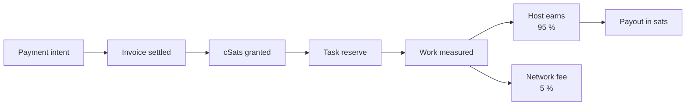

# Settlement Lifecycle

This page follows value through EdgeCoder: sats in, cSats spent on compute, sats out to hosts. The
canonical, current model with every formula and its source is
[docs/economy-math.md](https://github.com/codyrs82/Edgecoder/blob/main/docs/economy-math.md); if
this page and that one disagree, that one is right.

Today value sits with the coordinator between a purchase and a payout (custodial).

## Lifecycle Diagram

## Step-by-step

1. **Buy cSats.** `POST /economy/payments/intents` creates a Lightning invoice. Buying is free by
   default (`COORDINATOR_FEE_BPS` = 0): 1 sat buys 1 cSat.
2. **Settlement.** cSats are granted only when the coordinator's Lightning node (LND or CLN)
   reports the invoice settled, with preimage, amount and state checks. The grant row
   `credit_purchase:<intentId>` is unique per intent, so a repeated settlement grants nothing.
   Funding with Bitcoin on-chain uses the same price and is behind `ONCHAIN_ENABLED`.
3. **Reserve.** At submit the coordinator sets aside the worst case for the task (`task_reserve`)
   and refunds the unused part when the task finishes. Not enough balance returns 402
   `insufficient_credits`.
4. **Measure and charge.** Model calls are priced per token by model size, with a power floor per
   compute class; code jobs and reservations are priced per second by compute class, with seconds
   measured by the coordinator. Work on your own machines is not charged.
5. **Earn.** The host that ran the work gets what the requester paid less the network fee: 95 % to
   the host, 5 % to EdgeCoder (`NETWORK_FEE_BPS` = 500, booked to `network:fee_pool`). Each earn
   row carries the sats it was worth when earned.
6. **Payout.** Hosts withdraw earned sats over Lightning (`POST /economy/payouts/withdraw`), or are
   paid automatically to a Lightning address. Batched on-chain payouts are behind
   `ONCHAIN_ENABLED`. Purchased cSats are spendable but never withdrawable.

## Safeguards and reconciliation

- Payout caps per payout, per account per day and per coordinator per day; a kill switch
  (`POST /admin/payouts/pause`) that stops every payout.
- Periodic reconciliation compares the Lightning node with the ledger and pauses payouts on a
  mismatch (unknown payments, balance drops, solvency).
- Expired intents are never granted; settlement is idempotent.
- `/ledger/verify` checks the hash chain and flags overpaid tasks.

Details and the exact checks are in
[economy-math.md, section 5](https://github.com/codyrs82/Edgecoder/blob/main/docs/economy-math.md#5-payouts-sats-leave-the-ledger)
and [going-to-mainnet.md](https://github.com/codyrs82/Edgecoder/blob/main/docs/going-to-mainnet.md).

## Issuance

The daily token pool is computed and recorded, but tokens are not converted into cSats or paid
out. See [Credits, Pricing, and Issuance](/economy/credits-pricing-issuance#token-issuance).

## Related

- [Credits, Pricing, and Issuance](/economy/credits-pricing-issuance)
- [Bitcoin Anchoring](/economy/bitcoin-anchoring)
- [API Surfaces](/reference/api-surfaces)
