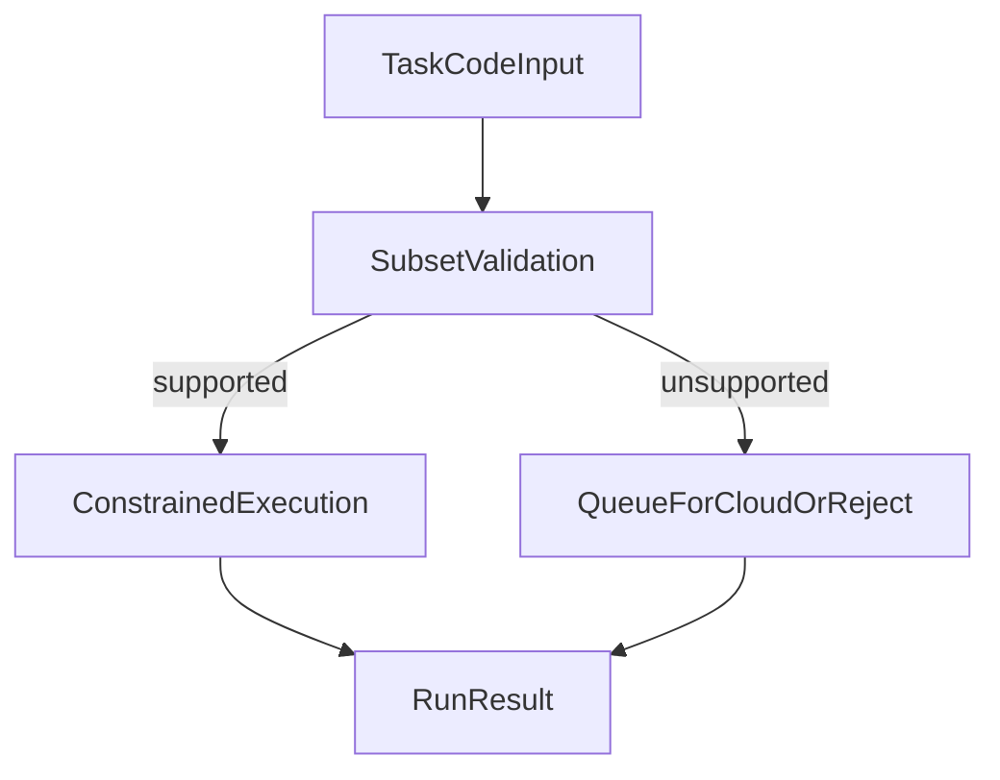

# Executor Sandbox and Isolation

The executor is a core safety boundary in EdgeCoder.
It decides whether generated code can run in constrained local runtime or must be rejected/queued.

## Design goals

- Limit unsafe language/runtime features.
- Keep execution deterministic enough for automated retries.
- Provide explicit reason codes for non-runnable payloads.

## Execution decision flow

## Run result contract (conceptual)

| Field | Purpose |
|---|---|
| `ok` | high-level success/failure flag |
| `stdout` | captured standard output |
| `stderr` | captured error output |
| `exitCode` | process result code |
| `durationMs` | execution duration for telemetry and policy |
| `queueForCloud` | indicates fallback path |
| `queueReason` | explains subset/policy/runtime fallback reason |

## Isolation concerns

- No implicit trust in generated code.
- Restrict language subset and dangerous constructs.
- Bound resource usage and timeout behavior.
- Return structured errors so the agent loop can recover/rewrite.

## Sandbox requirement for remote work

Code from anywhere other than the local user always runs in Docker. That covers coordinator `/pull` tasks, mesh gossip, BLE and peer-direct offers.

- `runCode()` defaults to `sandbox: "docker"` and `origin: "remote"`. A remote task asking for host execution gets `ok: false`, `stderr: "sandbox_required_for_remote_task"`, and no process is spawned.
- Remote-origin work never falls back to the host, whatever is configured.

## Local (IDE) runs

`InteractiveAgent` (the IDE provider's `/run` and `/run/local`) runs model-generated code with `origin: "local"`. That code also runs in the Docker sandbox, with the same flags. The images are built on first use if they are missing.

Without Docker, a local run fails with `sandbox_unavailable` unless the operator sets `EDGECODER_UNSAFE_HOST_EXECUTION=1`. With that set, the code runs on the host: JavaScript in `node:vm` and Python as `python3 -c`, both with the user's own privileges and environment. Only set it on a machine where running arbitrary model output as your user is acceptable.

## What the subset validators guarantee

The regex deny-list and the AST checks (`src/executor/subset.ts`, `ast-javascript.ts`, `ast-python.ts`) reject code outside the supported subset. That includes the common escape shapes: `.constructor` and `__proto__` access, dunder attributes such as `__class__` and `__subclasses__`, and references to `eval`, `exec`, `getattr` and similar builtins. They are a filter, not a security boundary. A deny-list over JavaScript or Python source cannot be complete; for example, a property name assembled at runtime is not seen. Isolation comes only from the Docker sandbox.
- With `SANDBOX_MODE=none` a worker still registers and heartbeats, but it never calls `/pull` and does not run mesh or peer code.
- **Inference-only mode.** With `SANDBOX_MODE=none` and `AGENT_INFERENCE_ONLY=1`, a worker does call `/pull`, and runs only `kind: "inference"` subtasks: a model on text, never task code. This is for GPU container hosts that cannot run Docker. It refuses any other subtask with `inference_only_agent` instead of running it; mesh, BLE and peer-direct code stay off.
- The coordinator lets an agent that reports `sandboxMode: "none"` (or no sandbox) claim inference subtasks only. The rule is applied inside the claim, so a code subtask is never claimed and then requeued for such an agent.
- Installer env examples default to `SANDBOX_MODE=docker`. Hosts without Docker contribute no code-execution compute.

### Container hardening

`buildDockerArgs()` always adds these flags:

`--pull=never`, `--network=none` (unless policy allows), `--read-only`, `--memory`, `--memory-swap` (equal to `--memory`), `--cpus`, `--pids-limit=50`, `--cap-drop=ALL`, `--security-opt=no-new-privileges`, `--user=65534:65534`, `--tmpfs=/tmp:rw,noexec,nosuid,size=64m`, `--ulimit=nofile=256:256`

It also adds `--security-opt=seccomp=$SANDBOX_SECCOMP_PROFILE` when that variable is set.

Sandbox images must run as `nobody` (uid 65534) and write only to `/tmp`.

## Operator checks

- Verify fallback rates do not spike unexpectedly.
- Track common `queueReason` values to improve prompt/executor alignment.
- Keep runtime policy consistent across worker fleets.

## Related pages

- [Executor Subset Reference](/operations/executor-subset-reference)
- [Threat Model](/security/threat-model)
- [Request Lifecycle Sequences](/guide/request-lifecycle-sequences)
