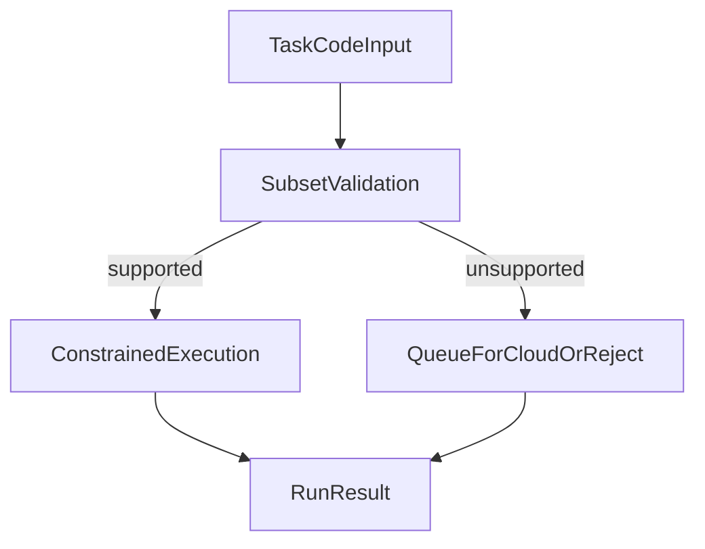

# Executor Sandbox and Isolation

The executor is a core safety boundary in EdgeCoder.
It decides whether generated code can run in constrained local runtime or must be rejected/queued.

## Design goals

- Limit unsafe language/runtime features.
- Keep execution deterministic enough for automated retries.
- Provide explicit reason codes for non-runnable payloads.

## Execution decision flow

## Run result contract (conceptual)

| Field | Purpose |
|---|---|
| `ok` | high-level success/failure flag |
| `stdout` | captured standard output |
| `stderr` | captured error output |
| `exitCode` | process result code |
| `durationMs` | execution duration for telemetry and policy |
| `queueForCloud` | indicates fallback path |
| `queueReason` | explains subset/policy/runtime fallback reason |

## Isolation concerns

- No implicit trust in generated code.
- Restrict language subset and dangerous constructs.
- Bound resource usage and timeout behavior.
- Return structured errors so the agent loop can recover/rewrite.

## Sandbox requirement for remote work

Code from anywhere other than the local user always runs in Docker. That covers coordinator `/pull` tasks, mesh gossip, BLE and peer-direct offers.

- `runCode()` defaults to `sandbox: "docker"` and `origin: "remote"`. A remote task asking for host execution gets `ok: false`, `stderr: "sandbox_required_for_remote_task"`, and no process is spawned.
- Only `InteractiveAgent` (IDE or local CLI) runs on the host, with `origin: "local"`.
- With `SANDBOX_MODE=none` a worker still registers and heartbeats, but it never calls `/pull` and does not run mesh or peer code.
- The coordinator also rejects `/pull` from agents that report `sandboxMode: "none"` before claiming a task, so nothing is claimed and then requeued.
- Installer env examples default to `SANDBOX_MODE=docker`. Hosts without Docker simply contribute no swarm compute.

### Container hardening

`buildDockerArgs()` always adds these flags:

`--network=none` (unless policy allows), `--read-only`, `--memory`, `--cpus`, `--pids-limit=50`, `--cap-drop=ALL`, `--security-opt=no-new-privileges`, `--user=65534:65534`, `--tmpfs=/tmp:rw,noexec,nosuid,size=64m`, `--ulimit=nofile=256:256`

It also adds `--security-opt=seccomp=$SANDBOX_SECCOMP_PROFILE` when that variable is set.

Sandbox images must run as `nobody` (uid 65534) and write only to `/tmp`.

## Operator checks

- Verify fallback rates do not spike unexpectedly.
- Track common `queueReason` values to improve prompt/executor alignment.
- Keep runtime policy consistent across worker fleets.

## Related pages

- [Executor Subset Reference](/operations/executor-subset-reference)
- [Threat Model](/security/threat-model)
- [Request Lifecycle Sequences](/guide/request-lifecycle-sequences)
