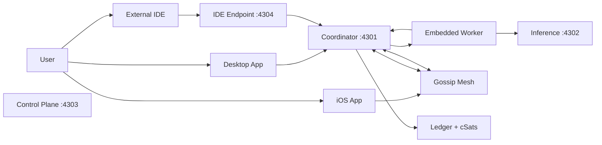

# How EdgeCoder Works

This page describes the EdgeCoder runtime architecture end to end: from node startup through task execution and settlement.

## Unified Agent Architecture

EdgeCoder has two kinds of node:

- **Coordinators** hold the task queue, the credit engine, the ledger and the peer mesh. The `all-in-one` runtime (what `npm run dev` and the Fly.io seeds run) puts a coordinator, the inference service and the control plane in one process, with an embedded worker in development (the Fly.io seeds disable it, `DISABLE_SELF_AGENT=1`). On the public network the coordinators are EdgeCoder's seeds: `edgecoder-seed` (US, coordinator-only) and `edgecoder-seed-eu` (EU, also runs Ollama).
- **Agents** (the desktop app, installed hosts, iOS) register with a coordinator, pull subtasks and run them on local models. An agent runs its owner's work for free; it takes other people's work only once its owner is an approved host. An iPhone hosts only while it is charging: it takes network jobs and serves nearby machines over Bluetooth.

When an `all-in-one` process boots:

1. The coordinator starts on **port 4301** and initializes the task queue, credit engine, ledger, and peer mesh.
2. An embedded worker starts, unless `DISABLE_SELF_AGENT` is set.
3. The inference service binds to **port 4302** (local Ollama).
4. The control plane binds to **port 4303**.
5. The OpenAI-compatible IDE provider runs as its own process on **port 4304** (`npm run dev:ide`).

## Gossip Mesh

Nodes discover and communicate with each other via a gossip mesh. Each node broadcasts state to peers over HTTP at `/mesh/ingest`. The mesh handles:

- Peer discovery and liveness
- Task availability broadcasts
- Claim coordination with gossip claim delay to prevent duplicate execution
- Ledger synchronization

The gossip mesh connects coordinators, and agents connect to a coordinator; it is not a serverless peer-to-peer network. On the public network the coordinators are EdgeCoder-operated, and the portal (accounts, host approval, wallet) is EdgeCoder-hosted. Agents can also make direct work offers to each other through the coordinator (agent-mesh), and nearby devices can reach each other over BLE.

## System Components

| Component | Role |
|---|---|
| **Coordinator** (port 4301) | Task queue, credit engine, ledger, peer mesh management |
| **Inference Service** (port 4302) | Local model execution via Ollama |
| **Control Plane** (port 4303) | Network mode controls, agent approvals, governance |
| **IDE Endpoint** (port 4304) | OpenAI-compatible API for VS Code, Cursor, Windsurf |
| **Embedded Worker** | Picks tasks from the local coordinator queue, executes them |

## User Interfaces

### Desktop App (Tauri + Svelte)

Chat-first IDE with Monaco editor, conversation history, model management, mesh topology view, task queue, and usage dashboard. This is the primary surface for interacting with EdgeCoder.

### External IDEs

VS Code, Cursor, and Windsurf connect to the node via the OpenAI-compatible endpoint on port 4304. Users get EdgeCoder inference inside their existing editor without switching tools.

### iOS App

EdgeCoder for iPhone and iPad is on the App Store. It has two modes, switched at the top of the first tab:

- **Chat** -- a chat with a model picker whose sections are **Auto** (your machines first, then the network), **On This Device** (models run on the phone with llama.cpp), **Nearby Devices** (models on devices found over Bluetooth), **My machines** (models on computers signed in to your account) and **EdgeCoder Network** (models on approved hosts, paid in cSats).
- **Code** -- drives coding sessions on your own computers from the phone. Turn on **Code from your phone** in the EdgeCoder desktop app; the session runs on that computer, relayed through the coordinator. The same sessions are under **Code** on [edgecoder.io](/guide/ios-app#code-on-edgecoder-io).

The App Store build does not sell cSats and does not show host earnings; buy cSats on the web ([Buy cSats](/guide/buy-csats)). How phones find nearby devices is in [BLE Local Mesh](/guide/ble-local-mesh).

## Task Flow

1. **Submission** -- User submits a task via the desktop chat UI or an external IDE.
2. **Queueing** -- The local coordinator places the task on its queue.
3. **Broadcast** -- The gossip mesh broadcasts task availability to peer coordinators.
4. **Claiming** -- An available worker (local or on a remote peer) claims the task. A gossip claim delay prevents duplicate claims across the mesh.
5. **Execution** -- The worker runs a plan, code, test, iterate loop against its local model.
6. **Result return** -- Results flow back to the originating coordinator. The host that ran the work is paid in cSats: what the requester paid, less the 5 % network fee.

## Economy

Compute is priced in **cSats** (1 cSat = 1 sat). The canonical, current model is [economy-math.md](https://github.com/codyrs82/Edgecoder/blob/main/docs/economy-math.md).

- **Earning sats**: Approved hosts earn for work they run for others: 95 % of each compute payment goes to the host and 5 % is the network fee (`NETWORK_FEE_BPS`). The coordinator measures the work and records it on the ledger.
- **Spending cSats**: Model calls are priced per token by model size (with a power floor per compute class); code jobs and reservations per second by compute class. Work on your own machines is free.
- **Payouts**: earned sats are withdrawn over Lightning, on request or automatically to a Lightning address. Funding with Bitcoin on-chain is behind `ONCHAIN_ENABLED`.
- **Bitcoin anchoring**: OP_RETURN anchoring of ledger checkpoints is implemented but not enabled yet on EdgeCoder's coordinators (which run on Bitcoin mainnet); checkpoints stop at quorum commit (`soft_finalized`). See [Bitcoin Anchoring](/economy/bitcoin-anchoring).

## Runtime Modes

### Local-Only

All tasks execute on the local node. The gossip mesh is inactive or restricted. Suitable for air-gapped environments or privacy-sensitive workloads.

### Mesh (Default)

The node participates in the mesh. Tasks can overflow to network capacity when local capacity is saturated, and, if its owner is an approved host, the node accepts other people's tasks and earns sats for them.

## Trust Boundaries

- **Identity**: Session and permission checks at task ingress.
- **Execution**: Workers run in constrained environments. Scheduling policy determines node eligibility per task class.
- **Network**: Mesh endpoints require peer authentication. The inference service is not exposed directly to the mesh.
- **Economy**: Credit accounting, issuance, and settlement are isolated from execution paths. Ledger verification provides auditability.

## Where to Go Deeper

- Architecture details: [Architecture Deep Dive](/guide/architecture-deep-dive)
- Operations: [Public Mesh Operations](/operations/public-mesh-operations)
- Security: [Trust and Security](/security/trust-and-security)
- Economy: [Credits, Pricing, and Issuance](/economy/credits-pricing-issuance)
- API reference: [API Surfaces](/reference/api-surfaces)
