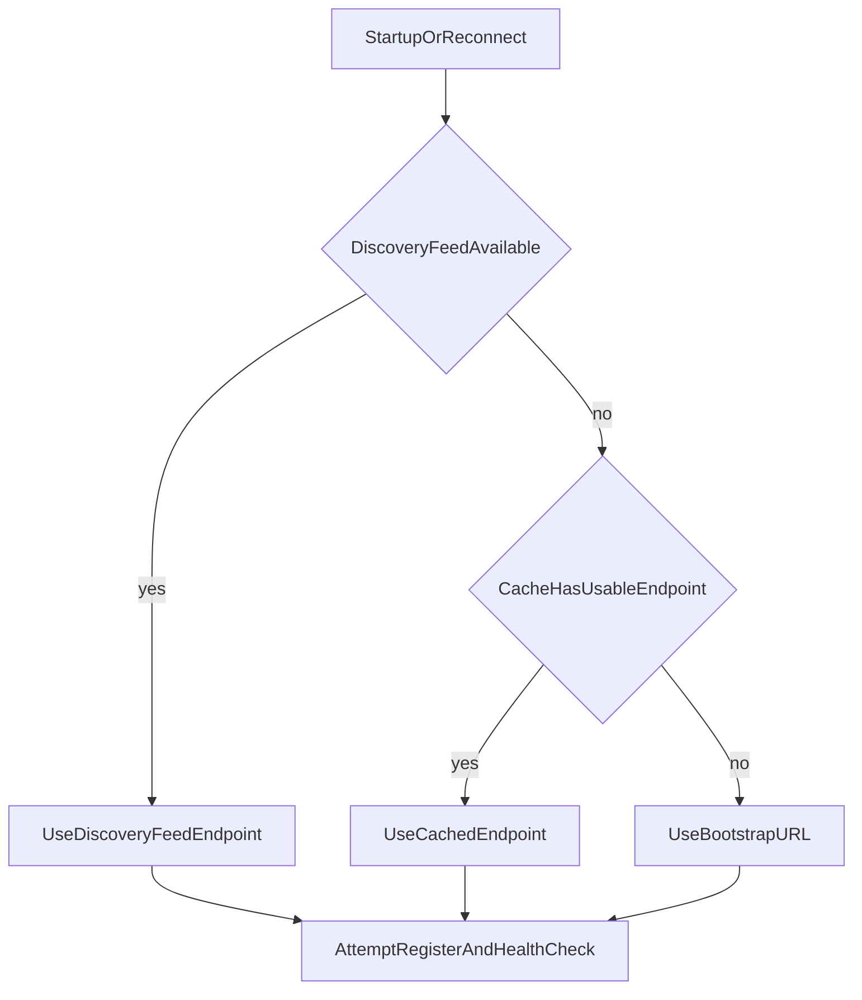

# Coordinator Discovery and Failover

Agents and coordinators must resolve active coordinator endpoints reliably.
EdgeCoder uses ordered discovery with cache and bootstrap fallback.

## Resolution order

## Data sources

- Discovery feed from control-plane network endpoints.
- Local cache file for last known good coordinator.
- Bootstrap URL as deterministic fallback.

## Common configuration keys

| Variable | Purpose |
|---|---|
| `CONTROL_PLANE_URL` | base for discovery feed |
| `COORDINATOR_DISCOVERY_URL` | explicit discovery feed override |
| `COORDINATOR_CACHE_FILE` | local worker cache file |
| `COORDINATOR_BOOTSTRAP_URLS` | fallback coordinator seed list |
| `COORDINATOR_PEER_CACHE_FILE` | local coordinator peer cache |

## Failure patterns and recovery

- **Discovery unavailable**: rely on cache/bootstrap, retry with backoff.
- **Stale cache endpoint**: health-check reject, fall through to next source.
- **Split-brain peer data**: prefer verified coordinator health and policy state.

## Restarts and deploys

A coordinator keeps connected agents and relay state in memory, so a restart is handled in steps.

| Step | What happens | Source |
|---|---|---|
| Drain | On `SIGTERM` / `SIGINT`, new jobs get a retryable `503 coordinator_draining` (nothing charged; a peer's URL when known), `/pull` answers no work, `/register` is refused and `/health/runtime` answers `503`. Claimed subtasks, results being paid and open requests get up to `COORDINATOR_DRAIN_MS` (default 25 s) to finish. | `src/swarm/coordinator/drain.ts` |
| Reconnect frame | Every connected agent gets a signed reconnect frame. It waits 2 to 10 s (jittered), registers again, then reopens its mesh socket. | `src/mesh/coordinator-reconnect.ts`, `src/swarm/worker-runner.ts` |
| Held binds | A mesh socket that arrives before its agent has registered is held, not refused. Registration checks the bind's signature and promotes it. A held socket is closed after 3 minutes with `4005 agent_not_registered`; at most 2,000 are held. | `src/swarm/coordinator/mesh-ws-bindings.ts` |
| Not registered | A signed request from an agent the coordinator doesn't know is answered with reason `agent_not_registered`. The agent registers again at once (at most once every 2 minutes) instead of counting failures toward offline mode. | `src/swarm/registration-policy.ts` |
| Liveness | The agent pings its mesh socket every 30 s and drops it if no pong came back, which reconnects it. This catches half-open sockets after a restart. | `src/swarm/worker-runner.ts` |
| Clients | Network inference from the desktop app, the hosted API and the web chat retries once after a draining answer. | `src/apps/ide/network-inference.ts`, `src/portal/routes/chat.ts` |
| Portal | Lookups of live machines ask every allowlisted coordinator, the healthy one first. | `src/portal/coordinator-fanout.ts` |

The seeds' Fly configs set `kill_signal = "SIGTERM"` and `kill_timeout = 35`, so the drain can
finish before Fly stops the machine. Work still running when the time is up is not lost: claims and
billing are in Postgres and the next instance restores them.

## Cross-links

- [Deployment Topology](/operations/deployment-topology)
- [Public Mesh Operations](/operations/public-mesh-operations)
- [Runtime Modes](/reference/runtime-modes)
